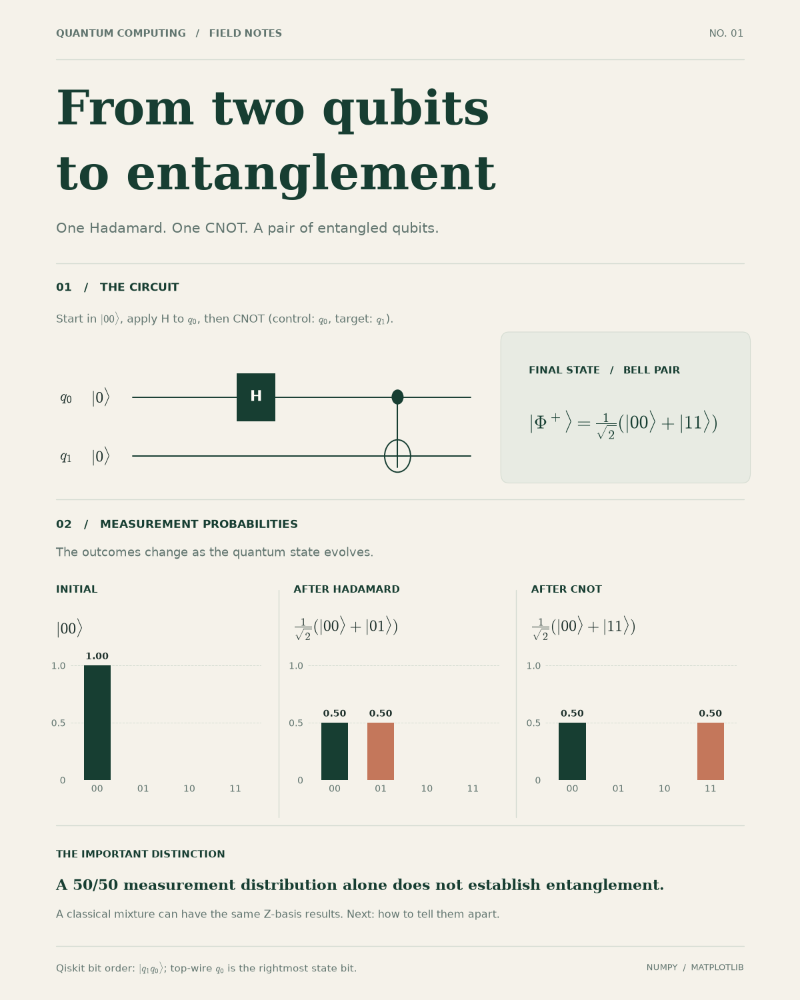

# Quantum Computing Field Notes

**Post 01 — From two qubits to entanglement**

Python simulation and an editorial-style LinkedIn visualization with a natural cream, forest, sage, and terracotta palette. The figure is generated from mathematically calculated probabilities, not AI-drawn charts.



## Bell-state experiment

Initial state: `|00⟩`. Apply H to q0, followed by CNOT(q0 → q1).

| Step | State | P(00) | P(01) | P(10) | P(11) |
|---|---|---:|---:|---:|---:|
| Initial | `|00⟩` | 1 | 0 | 0 | 0 |
| H(q0) | `(|00⟩ + |01⟩)/√2` | 0.5 | 0.5 | 0 | 0 |
| CNOT | `(|00⟩ + |11⟩)/√2` | 0.5 | 0 | 0 | 0.5 |

**Basis convention:** Kets are written `|q1 q0⟩` (Qiskit bit ordering). q0 is the *top circuit wire* but the *rightmost state bit*. This is why the intermediate state includes `|01⟩`, not `|10⟩`.

**Important:** The 50/50 Z-basis histogram alone cannot demonstrate entanglement. A classical mixture with equal populations in `|00⟩` and `|11⟩` has the same histogram. A Bell state's density matrix contains off-diagonal coherences and has `<X⊗X> = 1` whereas that classical mixture has `<X⊗X> = 0`.

## Run locally

Requires Python 3.10+.

```bash
python -m venv .venv
# macOS/Linux: source .venv/bin/activate
# Windows PowerShell: .venv\Scripts\Activate.ps1
pip install -r requirements.txt
python -m src.render_post
python -m unittest discover -s tests -v
```

The renderer produces `assets/bell_state_post.png` (1200 × 1500 pixels at 100 dpi) and `assets/bell_state_post.svg`.

The GitHub Actions workflow executes tests and regenerates/commits the images following changes to the renderer or simulation. See `notebooks/01_bell_state.ipynb` for an interactive walkthrough, and `linkedin_post_01.md` for the caption.

## Project files

- `src/bell_state.py` — NumPy statevectors, probabilities and density matrices
- `src/render_post.py` — editorial science graphic with Matplotlib
- `tests/test_bell_state.py` — seven mathematical checks
- `notebooks/01_bell_state.ipynb` — reproducible interactive exploration
- `linkedin_post_01.md` — LinkedIn post copy
- `assets/` — generated social graphic (PNG and SVG)
- `.github/workflows/build-visual.yml` — verify and regenerate visual assets

## Palette

Warm paper `#F5F2EA` · Forest green `#173E32` · Sage `#739584` · Terracotta `#C4775B`.

## Next post

**02 — Same probabilities, different physics**: entangled Bell state vs classical mixture through density matrices and X-basis correlations.
